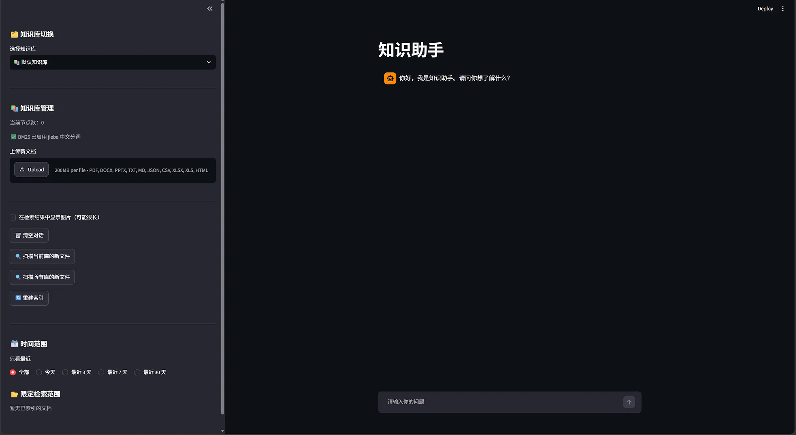
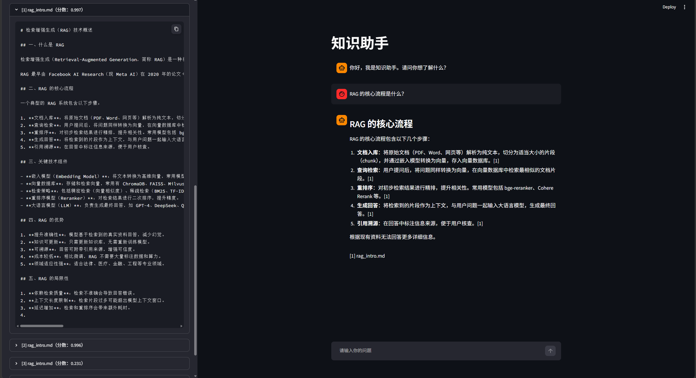

# 知识助手（RAG Knowledge Assistant）

基于 LlamaIndex + ChromaDB + Streamlit 的多知识库 RAG 问答系统，
支持本地 Ollama 与云端 DeepSeek 双后端切换。


## 功能特性

- 多知识库管理
- 混合检索：向量 + BM25 + Rerank
- 双 LLM 后端：本地 Ollama / 云端 DeepSeek
- 支持 PDF、PPTX、DOCX、CSV、Excel、Markdown、HTML
- 引用溯源，侧边栏折叠查看原文
- 文件级、时间范围级检索过滤

## 界面预览

<!-- 把 images/demo_main.png 换成你上传的那个主界面截图的实际文件名 -->


<!-- 把 images/demo_qa.png 换成你上传的那个问答截图的实际文件名 -->


## 系统架构

```mermaid
graph TD
    A[用户提问] --> B{混合检索}
    B -->|向量检索| C[(ChromaDB)]
    B -->|BM25关键词| D[本地文档节点]
    C --> E[Rerank 重排序]
    D --> E
    E --> F{LLM 生成}
    F -->|本地模式| G[Ollama qwen2.5]
    F -->|云端模式| H[DeepSeek API]
    G --> I[带引用的回答]
    H --> I
    I --> J[Streamlit 前端展示]